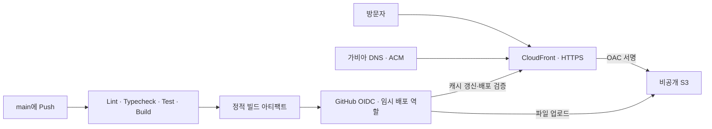

# SON JONGIN · Cloud Engineer & DevOps

서비스 요구사항에 맞는 인프라를 설계하고, 배포 자동화와 운영 과정의 문제를 해결하는 손종인의 포트폴리오입니다. 프로젝트 경험을 소개하는 웹사이트와 함께, 인프라 정의 및 애플리케이션 배포 흐름을 코드로 관리합니다.

[프로젝트 소스](https://github.com/Son-github/portfolio) · [연락처](mailto:jongin718@gmail.com) · [배포 구조](docs/DEPLOYMENT.md)

## 주요 프로젝트

| 프로젝트                                                      | 구분                        | 구현·검증 내용                                                                                      | 주요 기술                                                 |
| ------------------------------------------------------------- | --------------------------- | --------------------------------------------------------------------------------------------------- | --------------------------------------------------------- |
| [CloudWave](https://github.com/cw-5jang6bu)                   | 클라우드 인프라 팀 프로젝트 | Multi-AZ·EKS 인프라 설계, HPA·Karpenter 자동 확장, k6 부하 테스트를 통한 확장 동작 검증             | AWS, Kubernetes, Terraform, Redis, Datadog                |
| [Daily Briefing](https://github.com/Son-github/dailybriefing) | 개인 서비스 개발·운영       | Spring Boot 서비스를 ECS Fargate에 배포, GitHub Actions 배포 자동화, CloudWatch 로그 기반 오류 분석 | AWS, ECS Fargate, Spring Boot, RDS PostgreSQL, CloudFront |

이 저장소는 위 프로젝트를 소개하는 포트폴리오 웹사이트입니다. 프로젝트별 실제 구현 코드는 각 링크에서 확인할 수 있습니다.

## 이 저장소의 설계 포인트

- **서버 없이 제공하는 정적 웹사이트:** Next.js의 정적 내보내기로 S3와 CloudFront에서 제공할 수 있도록 구성했습니다.
- **인프라와 배포 권한 분리:** Terraform은 호스팅 리소스를 정의하고, GitHub Actions 역할은 해당 버킷의 파일 업로드와 해당 CDN의 조회·캐시 갱신만 허용합니다.
- **장기 인증 키 없는 배포:** GitHub OIDC의 저장소·브랜치 조건으로 `Son-github/portfolio`의 `main`만 AWS 임시 자격 증명을 발급받도록 정의했습니다.
- **검증한 산출물의 재사용:** PR에서는 검사와 빌드만 수행합니다. `main` 배포에서는 빌드 아티팩트를 그대로 사용하고, 배포 후 실제 HTML과 산출물의 SHA-256을 비교합니다.
- **콘텐츠 확장과 접근성:** 프로젝트·경력·기술 데이터를 UI와 분리했습니다. 반응형 레이아웃, 키보드 탐색, 모션 감소 설정을 지원합니다.

## 서비스와 배포 구조



호스팅은 비공개 S3와 CloudFront 종량제로 정의하고, DNS는 가비아에서 관리합니다. S3·배포 리전은 서울, CloudFront용 ACM 인증서는 버지니아로 분리했습니다. 별도의 상시 실행 서버·WAF·Route 53 영역은 구성하지 않습니다. CloudFront 무료 사용량 초과, S3 저장·요청, 도메인 갱신은 과금 대상입니다. 세부 리소스와 비용 범위는 [Terraform 안내](infra/terraform/README.md)에 정리했습니다.

자동 배포는 초기 인프라·OIDC 역할·GitHub 변수 설정 후 활성화됩니다. 현재 저장소에서는 웹사이트 코드와 인프라·CI/CD 정의를 제공합니다.

## 기술 스택

| 영역        | 구성                                                   |
| ----------- | ------------------------------------------------------ |
| 웹사이트    | Next.js 15, React 19, TypeScript, Tailwind CSS 4       |
| 인터랙션    | Motion, IntersectionObserver, CSS transform·opacity    |
| 인프라 정의 | Terraform, S3, CloudFront, OAC, ACM, 가비아 DNS        |
| CI/CD       | GitHub Actions, OIDC, 빌드 아티팩트, 배포 후 HTML 검증 |

## 로컬 실행

Node.js 20.9 이상이 필요합니다. CI는 Node.js 22를 사용합니다.

```sh
npm ci
npm run dev
```

[http://127.0.0.1:3000](http://127.0.0.1:3000)에서 확인하고, 서버를 실행한 터미널에서 **Control + C**로 종료합니다.

```sh
npm run lint
npm run typecheck
npm run test:deploy
npm run build
```

정적 결과물은 `out/`에 생성됩니다. `test:deploy`는 AWS 호출 없이 배포의 계정·원본·접근 제어 검사 로직을 검증합니다.

## 코드 탐색

```text
src/data/              프로젝트·경력·기술·프로필 데이터
src/components/        섹션·프로젝트·재사용 UI
src/hooks/             섹션 감지와 Reveal 동작
src/lib/animation.ts   공통 애니메이션 설정
infra/terraform/       호스팅·OIDC·최소 배포 권한 정의
.github/workflows/     PR 검증과 main 자동 배포
scripts/               정적 배포 도구와 로컬 테스트
```

- [개발·콘텐츠 관리](docs/DEVELOPMENT.md): 실행·종료, 프로젝트·경력 추가, 프로필 이미지와 모션 설정
- [처음 GitHub에 올리고 배포하기](docs/GETTING_STARTED.md): Git 초기화부터 최초 배포·도메인 연결까지
- [배포·운영 안내](docs/DEPLOYMENT.md): 초기 설정, GitHub Variables, 자동 배포 흐름과 복구 방법
- [Terraform 구성](infra/terraform/README.md): 리소스별 역할, 도메인 연결과 비용 범위
